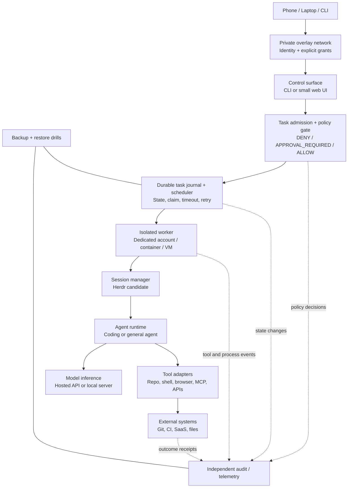

# 03 — Reference architecture

**Status:** proposed logical architecture; components not yet selected or deployed.

## Architecture principle

Keep **remote access, task policy, orchestration, worker execution, model inference, external tools and audit evidence** separate enough that a failure or compromise in one component does not automatically grant control over all others.

## Component responsibilities and boundaries

| Layer | Owns | Must not be assumed to provide |
|---|---|---|
| Host/OS | Power, storage, users, services, patching, firewall, resource limits | Agent-level policy or correct model reasoning |
| Private network | Device identity and permitted network paths | File permissions, tool authorization or protection from a compromised authorized device |
| Control surface | Task intake, user identity, status and approvals | Unrestricted remote shell or hidden privileged operations |
| Policy gate | Risk-based authorization before actions execute | A prompt that merely asks the model to “be careful” |
| Task journal/scheduler | Persisted state transitions, ownership, deadlines, retries and deduplication keys | Correctness of the task's result |
| Worker isolation | Limits process, filesystem, credentials and network scope | Perfect containment unless the actual boundary is tested |
| Session manager | Persistent terminal workspaces, detach/reattach, agent lifecycle visibility | Durable queue semantics, correct output, or action-level permissions |
| Agent runtime | Model/tool loop, prompts, context, agent-specific lifecycle | Trustworthiness of content consumed or outputs generated |
| Tool adapters | Narrow operation interfaces and resource-level checks | Safety if they forward raw credentials or give arbitrary shell access |
| Model inference | Token generation | Permission enforcement, source verification or truth guarantees |
| Audit/telemetry | Append-only task and action records, alerts, costs, receipts | Secret-safe logging by default; logs need redaction and access controls |
| Backup/recovery | Recoverable configuration, task journal and artifacts | Successful recovery until a restoration drill passes |

## Initial prototype shape

A restrained first prototype should use:

1. One dedicated Linux host or isolated VM.
2. Private-only remote access with a restrictive explicit policy.
3. A non-administrator service account and a separate workspace per repository/task.
4. Herdr only if its interactive terminal/workspace capabilities fit the selected coding-agent workflow.
5. A small external task journal and explicit scheduler mechanism if tasks must survive worker restart or be triggered on a schedule.
6. A provider abstraction so hosted inference can be evaluated first and local inference added only when a measured requirement justifies it.
7. A policy wrapper for tools/actions that classifies each action and enforces approval before state-changing operations.
8. Logs written outside the agent's control and scrubbed for tokens, private data and secrets.

This is a reference design, not a claim that these components are already present or integrated.

## Important boundary: Herdr vs orchestration

Herdr's official docs describe workspace/pane management, agent start/prompt/read/wait primitives, process persistence while detached, and restoration of session layout after restart [S4–S6]. The docs explicitly distinguish layout restoration from arbitrary process recovery [S5]. Therefore:

- Use Herdr as a **session and interaction layer** when it matches the coding-agent workflow.
- Add a durable task record and scheduler for scheduled/retryable jobs.
- Add action-level policy/approval outside the agent's free-form instructions.
- Verify support for the chosen agent, CLI, operating system and recovery case before depending on it.

## Model execution options

### Hosted inference

Advantages: minimal local compute requirements and access to capable models. Trade-offs: network/provider dependency, API/subscription rules, usage limits, data-handling requirements and variable costs.

### Local inference

Advantages: potential for offline execution and more local control over prompt data. Trade-offs: RAM/VRAM and performance limits, model quality variation, hardware cost/power, updates, serving security and local operations burden.

### Hybrid

Use local models for bounded low-risk tasks and hosted models for tasks that demonstrably require them, with explicit routing and budget controls. This is a hypothesis until benchmarked on actual jobs.

## Architecture decisions intentionally left open

- Physical machine vs cloud VM.
- Linux distribution and service manager.
- Herdr vs tmux or another session manager.
- OpenClaw or other general agent runtime vs coding agents alone.
- Specific task queue, database and dashboard.
- Hosted, local or hybrid inference.
- Exact remote-access policy syntax for the chosen tailnet.

Record each decision in an ADR and tie it to tested evidence.
